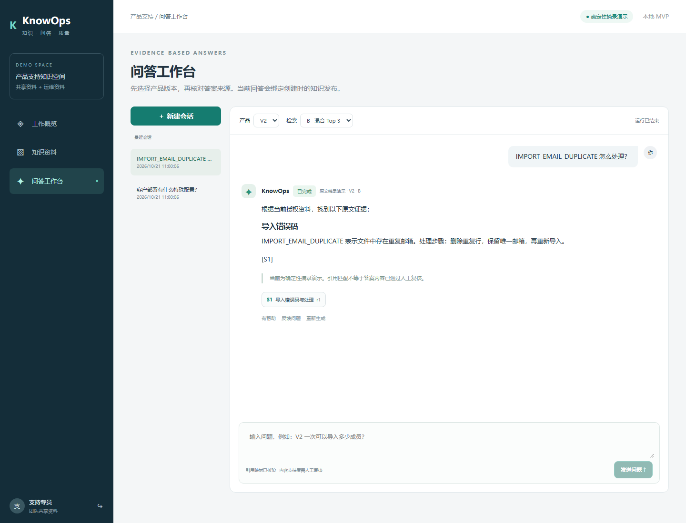
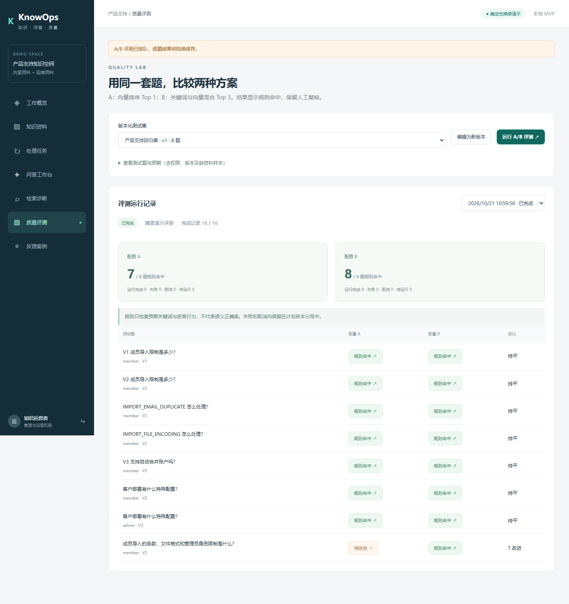

# KnowOps · AI 知识库与问答质量运营平台

一个可以本地运行、完整演示和追踪证据的 React 全栈作品。

**上传资料 → 异步处理 → 发布知识 → 流式问答 → 核对引用 → 反馈 → A/B 评测。**

默认不需要 API Key：使用明确标识的确定性原文摘录与本地特征向量演示。资料处理、数据库、向量查询、会话、权限、任务、SSE 和评测都是实际执行。演示回答不是大模型效果证明。



## 快速运行

需要 Node.js 22（本机验证 22.22.2）与 npm。不需要 Docker、Redis 或独立数据库。

```bash
npm ci
npm run build
npm start
```

打开 **http://127.0.0.1:5413**。首次启动初始化本地 Postgres、示例资料与 8 道回归题。

开发模式运行 `npm run dev`，访问 **http://127.0.0.1:5173**；API 仍使用 5413。

| 演示身份 | 邮箱 | 密码 | 权限 |
|---|---|---|---|
| 知识运营者 | `admin@example.test` | `DemoPass123!` | 资料、发布、运维资料、评测与诊断 |
| 支持专员 | `member@example.test` | `DemoPass123!` | 已授权共享资料、自己的问答与反馈 |

账户和资料全部为虚构的 demo-only 内容。登录会创建随机 HttpOnly 会话；不通过请求头声明身份。

## 可以演示什么

- **资料入库**：上传 Markdown、TXT、简单文本 PDF；查看排队、解析、切分、索引、就绪、失败与重试。文件上限 5 MB。
- **发布与修订**：上传新修订，预览片段，手动发布清单；历史问答绑定原发布和原修订。
- **授权检索**：空间、产品版本、当前资料权限与索引配置进入 SQL 查询。默认是真实 pgvector 精确距离查询，向量来自 48 维字面特征。
- **流式问答**：按 `runId + sequence` 持久化事件；断线回放、重复事件去重、取消、重生成与会话隔离。
- **引用与诊断**：引用对应资料修订、片段、页码或段落；运营者可查看候选排序、实际上下文与耗时。
- **反馈转回归题**：填写预期关键词或拒答要求，保存为测试集新版本。
- **真实执行 A/B 对照**：同一发布与测试集，分别运行向量 Top 1 和混合 Top 3；展示每题答案、失败、取消、改进与退步，并支持人工复核。



截图来自浏览器实际操作，使用虚构数据。截图中的规则命中数不代表真实模型准确率。

## 模型与 Embedding 接入

复制 `.env.example` 为 `.env`，修改后重启服务。密钥只由服务端读取，不进入前端。

生成模型配置：

```dotenv
GENERATION_MODE=openai-compatible
MODEL_API_BASE=https://your-provider.example/v1
MODEL_API_KEY=your-local-secret
MODEL_NAME=your-model
MODEL_TIMEOUT_MS=45000
```

适配使用 `/chat/completions` 的 SSE 协议。支持中文分块、取消、错误、429、断流和非正常结束原因。`length`、`content_filter`、`tool_calls` 不会伪装成完整成功。

向量配置独立：

```dotenv
EMBEDDING_API_BASE=https://your-provider.example/v1
EMBEDDING_API_KEY=your-local-secret
EMBEDDING_MODEL=your-embedding-model
# 如供应商支持指定维度，可设置 EMBEDDING_DIMENSIONS。
```

配置真实 Embedding 后，需要重新上传资料的新修订并发布。默认本地特征索引与远程索引不混合；索引键绑定接口地址、模型和返回维度。仅配置一部分变量会明确报错。

**已验证：受控本地 HTTP 上游的协议与故障场景。尚未验证：任何商业模型服务的实际效果、费用、可用性。** 默认启动不会产生外部模型调用。

## 工程与状态边界

```text
src/pages/             中文业务页面
src/components/        通用交互组件
src/stream.ts          当前运行、SSE 游标、缓冲与重连
shared/                运行契约和 SSE 解码/状态规则
server/app.ts          会话、授权、输入校验与 HTTP/SSE
server/engine.ts       持久任务、发布、运行、取消和评测
server/knowledge.ts    解析、切分、向量适配与授权检索
server/provider.ts     摘录演示和真实模型流式适配
server/db.ts           PGlite schema、用户与会话持久化
tests/                 协议、集成、重启与故障边界
tests/browser/         浏览器完整业务链
```

正文增量按运行独立保存，普通资料与任务交给 TanStack Query；已完成消息从服务端记录恢复。模型密钥、权限裁决与发布指针留在服务端。

详细实现见 [架构说明](docs/ARCHITECTURE.md)、[演示步骤](docs/DEMO.md)、[验收证据](docs/ACCEPTANCE.md)、[范围边界](docs/SCOPE.md)。

## 验证

```bash
npm run check
npm test
npm run build
npx playwright install chromium
npm run test:browser
```

浏览器测试通过单次启动脚本生成独立 `data/browser-suites/run-*` 数据目录，使用 **5513** 端口；可通过 `KNOWOPS_TEST_PORT` 指定其他独立端口（禁止 5413）。测试不复用正在运行的服务，端口占用会直接报错，不会改动演示数据。每轮强制演示生成和本地特征向量，避免加载本地模型凭据。测试截图保存在 `docs/screenshots`，临时故障截图留在忽略的 `test-results`。

GitHub Actions 执行安装、类型检查、自动化测试、生产构建及 Chromium 浏览器验证。源码发布不等于网站已公开部署。

## 数据重置

默认数据保存在本仓库的 `data/knowops`，已从 Git 排除。先停止服务，再运行：

```bash
npm run reset -- --confirm
```

该命令只删除本仓库默认演示数据库。自定义 `DATA_DIR` 不由此命令删除。下次启动会重建虚构示例数据。

## 当前实现范围

这是个人作品 MVP，默认使用 **PGlite 文件持久化 + 单进程任务调度器**，没有假装接入 Redis/BullMQ 或多实例部署。PDF 使用 PDF.js 提取文字，浏览器打开原始 PDF 的页码；没有 OCR、复杂表格还原或精确坐标高亮。

上线前需要替换公开演示账户，配置 HTTPS/安全 Cookie、备份、资源限额、外部持久服务和监控。详见 [SCOPE](docs/SCOPE.md)。
